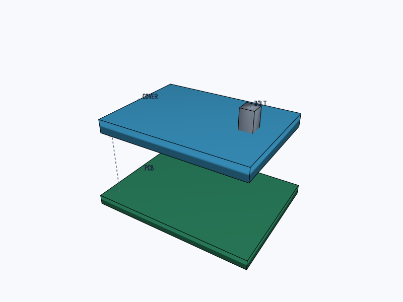

# @tscircuit/graphics-debug-3d

Serializable 3D debug scenes with PoppyGL PNG snapshots and an orbitable React
viewer. The same software renderer draws both, without WebGL or a browser in tests.



```ts
import {
  renderGraphics3dToPng,
  type GraphicsObject3d,
} from "@tscircuit/graphics-debug-3d"

const graphics: GraphicsObject3d = {
  meshes: [
    {
      positions: [0, 0, 0, 10, 0, 0, 0, 10, 0],
      indices: [0, 1, 2],
      color: "#3283b5",
    },
  ],
  lines: [
    {
      points: [
        [0, 0, 0],
        [0, 0, 10],
      ],
      dashed: true,
      arrow: true,
    },
  ],
  labels: [{ text: "Lift", position: [0, 0, 10] }],
}
const png = await renderGraphics3dToPng(graphics, { width: 800, height: 600 })
```

```tsx
import { InteractiveGraphics3d } from "@tscircuit/graphics-debug-3d/react"

;<InteractiveGraphics3d graphics={graphics} />
```

Coordinates are right-handed, +Z up. Meshes use packed XYZ arrays and triangle
indices. `position` translates a mesh; all input arrays remain unchanged. Colors
are six-digit hex; mesh `opacity` defaults to one. Movement polylines are
depth-tested PoppyGL guides, with optional dashes and arrows. Labels are screen
annotations anchored to world positions. `bounds` can include the complete motion
envelope so the camera stays stable between stages. Explicit camera position and
target are supported for snapshots. Drag to orbit, scroll to zoom, or reset the view.

This initial API covers meshes, lines, labels and framing. Picking, editable
geometry, scene hierarchies and GPU rendering are outside this first version.

```sh
bun install
bun test
bun run typecheck
bun run start
bun run build:site
```

Created through [tscircuit/create-repo #104](https://github.com/tscircuit/create-repo/pull/104)
using the [handbook's source-package conventions](https://github.com/tscircuit/handbook/blob/main/guides/bootstrapping-repos.md).
